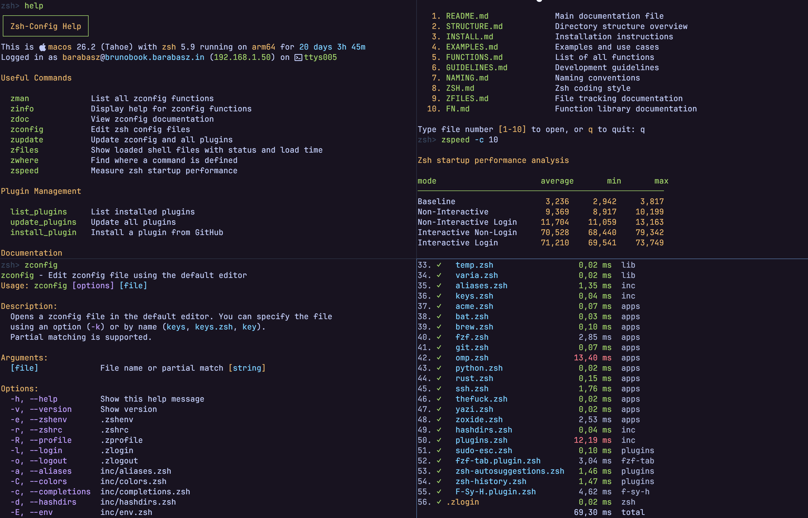

# zconfig

**zconfig** is a modern, modular, and performance-optimized Zsh framework architected for maintainability and near-instant startup. It eschews the overhead of bloated frameworks in favor of a lightweight, custom-tailored architecture that prioritizes speed without sacrificing power.

Its purpose is simple: to set up a complete Zsh working environment on a new machine in minutes, and to keep commands and workflow identical across all machines you use.

Whether you are a Zsh power user or just taking your first steps in the terminal, zconfig is built for you. It provides beginners with a stable, "batteries-included" environment out of the box, while offering veterans the modular flexibility needed to deeply customize and refine their workflow.

👉 For installation instructions, see [INSTALL.md](docs/INSTALL.md).



## Key Technical Pillars

- **Modular Architecture:** The configuration is organized into specialized files and directories with a strict separation of concerns, making it easy to navigate, debug, and extend.
- **Robust Function Framework**: Includes `fn.zsh`, a dedicated library for building professional Zsh functions. It provides standardized metadata handling, automated help generation, robust option parsing, and strict argument validation/type checking.
- **Automatic Bytecode Compilation:** To ensure maximum responsiveness, `zconfig` automatically handles `zcompile` for all configuration scripts, leveraging `.zwc` files for faster execution.
- **Modern Prompt Engine:** Leverages [oh-my-posh](https://ohmyposh.dev/) as its primary prompt engine for a highly customizable, themeable, and cross-shell experience.
- **Advanced Syntax Highlighting:** Integrates [F-Sy-H](https://github.com/z-shell/F-Sy-H) (Fast-Syntax-Highlighting), providing a more feature-rich and performant alternative to standard highlighting plugins.
- **Lightweight Plugin System:** Built with zero Oh-My-Zsh dependencies, it features a streamlined management system to add and update plugins without sacrificing performance.
- **Intelligent Completions:** Combines [zsh-autosuggestions](https://github.com/zsh-users/zsh-autosuggestions) for fluid, fish-like command suggestions with [fzf-tab](https://github.com/Aloxaf/fzf-tab) to replace the standard completion menu with a high-performance fuzzy-search interface.
- **File Tracking System:** Includes the `zfiles` command to track all sourced files with their respective load times and status, making it easy to identify bottlenecks and optimize startup performance.

## Documentation

| File | Description |
|------|-------------|
| [EXAMPLES.md](docs/EXAMPLES.md) | Examples and use cases |
| [FN.md](docs/FN.md) | Function library for building standardized functions |
| [FUNCTIONS.md](docs/FUNCTIONS.md) | List of all available functions |
| [GUIDELINES.md](docs/GUIDELINES.md) | Development guidelines |
| [INSTALL.md](docs/INSTALL.md) | Installation instructions |
| [NAMING.md](docs/NAMING.md) | Naming conventions |
| [STRUCTURE.md](docs/STRUCTURE.md) | Directory structure |
| [ZAPP.md](docs/ZAPP.md) | Application recipes (`zapp`) |
| [ZFILES.md](docs/ZFILES.md) | File tracking system |
| [ZSH.md](docs/ZSH.md) | Zsh coding style |

## Philosophy

1. **Performance First** - Track loading times, lazy load heavy apps, minimize startup
2. **Modularity** - Each component in separate file with single responsibility
3. **Zsh-Native** - No bash compatibility, use zsh-specific features exclusively
4. **Explicit Over Implicit** - Clear naming conventions, documented behavior

## Components

| Location | Purpose | Details |
|----------|---------|---------|
| `.zshenv`, `.zshrc`, ... | Startup files | [STRUCTURE.md](docs/STRUCTURE.md#startup-order) |
| `inc/` | Core configuration modules, one concern per file | [STRUCTURE.md](docs/STRUCTURE.md) |
| `lib/` | Helper function library | [FUNCTIONS.md](docs/FUNCTIONS.md) |
| `functions/` | Autoloaded user commands | [FUNCTIONS.md](docs/FUNCTIONS.md), [FN.md](docs/FN.md) |
| `apps/` | Integrations with external tools | [GUIDELINES.md](docs/GUIDELINES.md#app-integrations-apps) |
| `recipes/` | Application recipes for `zapp` | [ZAPP.md](docs/ZAPP.md) |
| `plugins/` | Lightweight plugin system, without Oh-My-Zsh | [GUIDELINES.md](docs/GUIDELINES.md#plugins-plugins) |

## Configuration Variables

All configuration variables are defined in `inc/env.zsh` with sensible defaults. Override them by setting before shell startup (e.g., `ZSH_DEBUG=0 zsh`).

| Variable | Default | Description |
|----------|---------|-------------|
| `ZSH_DEBUG` | 1 | Enable debug messages |
| `ZSH_ZFILE_DEBUG` | 0 | Enable file tracking debug messages |
| `ZSH_LOGIN_INFO` | 0 | Show login info on startup |
| `ZSH_SYS_INFO` | 0 | Show system info on startup |
| `ZSH_AUTOCOMPILE` | 1 | Auto-compile `.zsh` to `.zwc` bytecode |
| `ZSH_LOAD_LIB` | 1 | Load library files from `lib/` |
| `ZSH_LOAD_USER_FUNCS` | 1 | Load functions from `functions/` |
| `ZSH_LOAD_SHELL_FUNCS` | 1 | Autoload shell functions (zargs, zmv, etc.) |
| `ZSH_LOAD_APPS` | 1 | Load app configurations from `apps/` |
| `ZSH_LOAD_PLUGINS` | 1 | Load plugins from `plugins/` |
| `ZSH_PLUGINS_AUTOINSTALL` | 1 | Auto-install missing plugins |
| `ZSH_LOAD_KEYS` | 1 | Load key bindings from `keys.zsh` |
| `ZSH_LOAD_ALIASES` | 1 | Load aliases from `aliases.zsh` |
| `ZSH_LOAD_COLORS` | 1 | Load colors from `colors.zsh` |
| `ZSH_LOAD_COMPLETION` | 1 | Load completion config from `completion.zsh` |
| `ZSH_LOAD_HASHDIRS` | 1 | Load directory hashes from `hashdirs.zsh` |
| `ZSH_LOAD_OPTIONS` | 1 | Load shell options from `options.zsh` |

**Examples:**
```zsh
# Minimal shell (no apps, no plugins)
ZSH_LOAD_APPS=0 ZSH_LOAD_PLUGINS=0 zsh

# Debug a plugin issue
ZSH_LOAD_PLUGINS=0 zsh

# Quiet mode (no debug output)
ZSH_DEBUG=0 zsh
```

## Bytecode Compilation

Zsh files are automatically compiled to `.zwc` bytecode for faster loading (~10% speedup). See [GUIDELINES.md](docs/GUIDELINES.md#bytecode-compilation).

## Best Practices

See [GUIDELINES.md](docs/GUIDELINES.md) for project rules, file types, and performance tips, and [ZSH.md](docs/ZSH.md) for coding style.

## Troubleshooting

### Shell Starts Slowly

1. Run `zspeed` to benchmark startup time across shell modes
2. Run `zfiles` to identify slow files (> 10ms is suspicious)
3. Use `zinfo -i <command>` to inspect specific tools and their load cost
4. Consider lazy loading heavy apps (see [EXAMPLES.md](docs/EXAMPLES.md#lazy-loading-pattern))
5. Check for unnecessary external commands — prefer zsh builtins

### Function Not Found

1. Run `zman` to list all available functions
2. Run `zinfo <name>` to check if the command exists and where it's defined
3. For `functions/`: verify the file exists and has correct permissions
4. Reload the shell: `reload` or `exec zsh`

### Changes Not Applied

1. Run `reload` to restart the shell with the new configuration
2. After editing `functions/` or `lib/`: `reload_zconfig` reloads them in the current shell
   (`zupdate` does this automatically after pulling changes)

### Check Installation

Run `zcheck` to verify zconfig installation, directory structure, and loaded components.

## References

### zconfig Tools

The most important commands; all of them are listed in [FUNCTIONS.md](docs/FUNCTIONS.md).

| Command | Description |
|---------|-------------|
| `zhelp` | Display helpful commands and documentation |
| `zdoc` | Browse and view documentation files |
| `zman` | List all functions from `lib/` and `functions/` |
| `zapp` | Install applications and link their configuration |
| `zgit` | Git wrapper for bulk operations on repositories |
| `zinfo` | Display version, path, and description of any command |
| `zfiles` | Show loaded shell files with status and load time |
| `zspeed` | Measure zsh startup performance |
| `zcheck` | Check zconfig installation and configuration |
| `zconfig` | Edit zconfig files using the default editor |
| `zupdate` | Update zconfig, plugins, and system packages |

### Zsh Documentation

- `man zshall` — complete zsh manual
- `man zshexpn` — parameter expansion
- `man zshbuiltins` — builtin commands
- `man zshcompsys` — completion system
